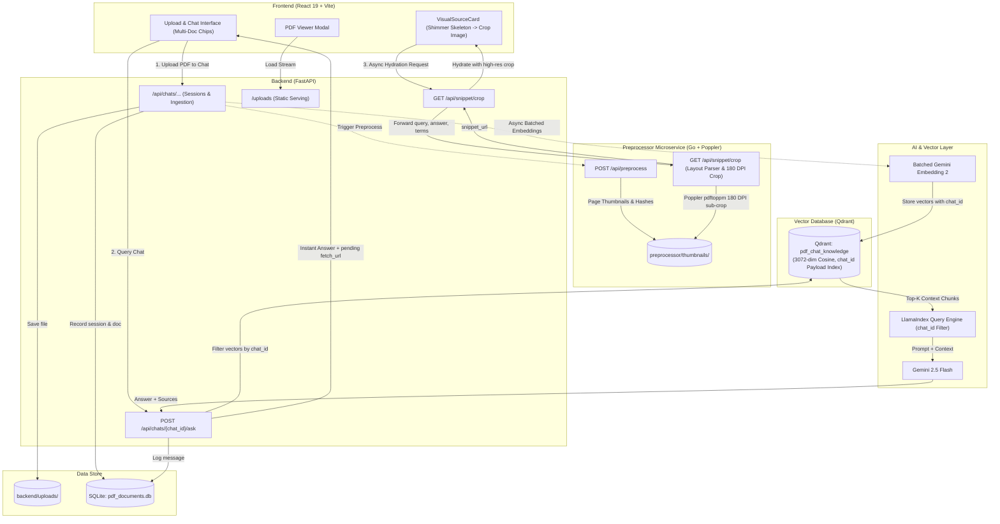

<div align="center">

# 📄 PDF Reviewer & AI Query Engine

**Chat with your PDF documents with grounded answers and verifiable page citations.**

Powered by **FastAPI**, **React 19**, **Qdrant Vector DB**, **LlamaIndex**, and **Google Gemini 2.5 Flash**.

[](https://pdf-query-app-delta.vercel.app/)
[](https://fastapi.tiangolo.com)
[](https://qdrant.tech/)
[](https://react.dev/)
[](https://vitejs.dev/)
[](https://ai.google.dev/)
[](https://www.llamaindex.ai/)
[](https://go.dev/)
[](https://www.docker.com/)

---

[Explore Features](#-key-features) •
[System Architecture](#-system-architecture) •
[API Reference](#-api-endpoints) •
[Docker Setup](#-docker-setup-recommended) •
[Quickstart](#-manual-quickstart-guide) •
[Environment Variables](#-environment-variables)

</div>

<br />

## 🌟 Overview

**PDF Reviewer** is a full-stack, AI-driven document intelligence platform. Users can upload any PDF—ranging from academic papers and technical specs to resumes and financial reports—and interact with its contents conversationally.

Instead of generic responses or hallucinations, the application uses **Retrieval-Augmented Generation (RAG)** to retrieve relevant document segments and pass them as context to **Gemini 2.5 Flash**, accompanied by **page-level source citations**.

---

## ✨ Key Features

- **📚 Multi-Document Chat Sessions**: Attach multiple PDF files to a single conversation session. The AI synthesizes knowledge seamlessly across all attached documents with distinct document chips and source attributions.
- **🛡️ Qdrant Vector Engine & Strict Chat Isolation**: Powered by **Qdrant** (Rust) with HNSW cosine similarity search. Embeddings are tagged with indexed `chat_id` payload filters, guaranteeing zero vector cross-talk between different conversations.
- **⚡ Large PDF Ingestion & Batched Embeddings**: Reliably indexes large documents (50+ pages, 200+ chunks) using API-level array batching (up to 40 chunks per request) and automatic exponential backoff retry on HTTP 429 rate limits.
- **🔍 Universal Visual Source Citations**: Instead of illegible whole-page thumbnails, a dedicated **Go Preprocessor microservice** performs layout analysis (`pdftotext -bbox-layout`) and relative font-height typography to locate the exact citation region, rendering a crisp **$180\text{ DPI}$ sub-rectangle crop** using Poppler's `pdftoppm`.
- **🌊 Progressive Frontend Hydration**: AI answers return immediately with zero visual cropping lag; source cards progressively hydrate in the chat using a sleek shimmer skeleton while Go crops the image in the background.
- **🖼️ Go Microservice for Processing**: Concurrently computes SHA-256 deduplication hashes, page thumbnails, and visual citation snippets with deterministic MD5 content-addressable caching.
- **📑 Verifiable Attribution**: Every answer provides collapsed-by-default source cards showing the exact page number, text snippet, document filename, and high-res visual snapshot.
- **👁️ Live PDF Previewer**: Built-in modal viewer allows quick side-by-side inspection of any attached PDF while chatting.
- **💬 Persistent Guest Sessions & Cascading Cleanup**: Chat sessions and document metadata are persisted in SQLite; deleting a document or conversation automatically cascades and purges all corresponding vectors from Qdrant.
- **🎨 Polished Minimal UI**: Clean, single-view chat layout built with React 19, Framer Motion animations, Markdown rendering, and friendly non-technical notifications.

---

## 🏗️ System Architecture



> 📖 **Deep-Dive Architecture Guide**: For complete details on the typography algorithms, relative font scaling ($H \ge 1.22 \times H_{\text{median}}$), upward/downward boundary crawling, and coordinate scaling, see **[preprocessor/VISUAL_CITATION_ARCHITECTURE.md](./preprocessor/VISUAL_CITATION_ARCHITECTURE.md)**.

---

## 🛠️ Tech Stack

| Domain | Technology | Description |
| :--- | :--- | :--- |
| **Frontend** | React 19, Vite | Minimal single-view interface with multi-document navbar chips, instant modal previewer, and progressive citation hydration |
| **Styling & UI** | Framer Motion, Bootstrap 5, React Icons | Shimmer loading skeletons, smooth animations, visual feedback |
| **Markdown** | React Markdown | Formatted rendering of AI answers |
| **Backend** | FastAPI, Uvicorn | High-performance Python async web framework |
| **Vector Database** | Qdrant (Rust) | Production-grade vector store with HNSW indexing, payload filtering, and strict chat isolation |
| **Preprocessor Microservice** | Go 1.23, Poppler (`poppler-utils`) | Universal visual citation sub-crop engine, page thumbnails & SHA-256 deduplication |
| **LLM & RAG** | LlamaIndex, Google Gemini API | `gemini-2.5-flash` (LLM) & `gemini-embedding-2` (Embeddings) |
| **PDF Extraction** | PyMuPDF, pypdf | Fast PDF text parsing and page metadata extraction |
| **Relational Database** | SQLite, SQLAlchemy 2.0 | Chat sessions, document registry, and conversation history |
| **Deployment** | Docker Compose | Multi-container setup (Backend, Qdrant, Go Preprocessor, Frontend) |

---

## 📡 API Endpoints

| Method | Endpoint | Description | Request Body / Params |
| :--- | :--- | :--- | :--- |
| `POST` | `/api/chats/` | Creates a new chat conversation session | JSON: `{ title }` |
| `GET` | `/api/chats/` | Lists all chat sessions with document counts | None |
| `GET` | `/api/chats/{chat_id}` | Retrieves full chat details, attached documents, and message history | URL path param |
| `PATCH` | `/api/chats/{chat_id}` | Renames a chat conversation | JSON: `{ title }` |
| `DELETE` | `/api/chats/{chat_id}` | Deletes chat, cascading removal of records and vectors in Qdrant | URL path param |
| `POST` | `/api/chats/{chat_id}/documents` | Attaches and indexes a PDF into Qdrant for this chat session | Multipart Form: `file` (.pdf) |
| `DELETE` | `/api/chats/{chat_id}/documents/{doc_id}` | Removes a document and purges its vectors from Qdrant | URL path params |
| `POST` | `/api/chats/{chat_id}/ask` | Queries all PDFs attached to this chat with strict Qdrant isolation | JSON: `{ question }` |
| `GET` | `/api/snippet/crop` | Proxies visual sub-rectangle citation cropping to Go microservice | Query: `filename`, `page`, `query`, `terms`, `answer` |
| `GET` | `/uploads/{filename}` | Serves the uploaded PDF file statically | URL path param |
| `GET` | `/` | Health check endpoint | None |

---

## 🐳 Docker Setup (Recommended)

Run the entire full-stack application (FastAPI backend, Qdrant vector database, Go preprocessor, and React frontend) with a single command.

### 1. Set Your Gemini API Key
Create a `.env` file at the project root (copied from [.env.example](file:///.env.example)):
```bash
cp .env.example .env
```
Add your key inside `.env`:
```env
GOOGLE_API_KEY=AIzaSy...
```

### 2. Run with Docker Compose
```bash
# Build and run backend, qdrant, preprocessor, and frontend
docker compose up --build
```
- **Frontend**: http://localhost:5173
- **Backend API & Swagger Docs**: http://localhost:8000/docs
- **Qdrant Dashboard & Web UI**: http://localhost:6333/dashboard
- **Go Preprocessor & Health**: http://localhost:8001/health

> [!NOTE]
> Uploaded PDFs, Qdrant vector storage, page thumbnails, and SQLite chat history are persisted across restarts in named Docker volumes (`backend_uploads`, `qdrant_storage`, `backend_data`, and `preprocessor_thumbnails`).

### 🛠️ Development Mode with Hot-Reloading
If you are developing and want live code changes reflected instantly without rebuilding images:
```bash
docker compose -f docker-compose.dev.yml up --build
```

---

## 🚀 Manual Quickstart Guide

### 1. Prerequisites

- **Node.js** (v18+) & **npm**
- **Python** (v3.10+)
- **Docker** (recommended for running Qdrant) or a running Qdrant instance
- **Google Gemini API Key** (obtainable from [Google AI Studio](https://aistudio.google.com/))

---

### 2. Clone the Repository

```bash
git clone https://github.com/shibinshibii/pdf-query-app.git
cd pdf-query-app
```

---

### 3. Vector Database (Qdrant)

Run a local Qdrant container:
```bash
docker run -d --name qdrant \
  -p 6333:6333 -p 6334:6334 \
  -v qdrant_storage:/qdrant/storage \
  qdrant/qdrant:v1.12.1
```
> The Qdrant Web UI will be accessible at `http://localhost:6333/dashboard`.

---

### 4. Backend Setup

```bash
cd backend

# Create and activate virtual environment
python -m venv venv
source venv/bin/activate  # On Windows: venv\Scripts\activate

# Install dependencies
pip install -r requirements.txt

# Configure environment variables
cp .env.example .env
```

Edit `backend/.env` with your credentials:
```env
DATABASE_URL=sqlite:///./pdf_documents.db
GOOGLE_API_KEY=your_actual_gemini_api_key_here
ALLOWED_ORIGINS=http://localhost:5173
QDRANT_URL=http://localhost:6333
PREPROCESSOR_URL=http://localhost:8001
PREPROCESSOR_PUBLIC_URL=http://localhost:8001
```

Start the backend server:
```bash
uvicorn app.main:app --reload --port 8000
```
> Server will be live at `http://localhost:8000` (API Docs at `http://localhost:8000/docs`).

---

### 5. Frontend Setup

In a new terminal window:

```bash
cd frontend

# Install packages
npm install

# Configure environment variables
cp .env.example .env
```

Ensure `frontend/.env` points to your backend:
```env
VITE_API_URL=http://localhost:8000
```

Start the Vite development server:
```bash
npm run dev
```
> Application will be accessible at `http://localhost:5173`.

---

## ⚙️ Environment Variables

### Backend (`backend/.env`)

| Variable | Required | Description | Example |
| :--- | :--- | :--- | :--- |
| `GOOGLE_API_KEY` | **Yes** | API key for Gemini models and embeddings | `AIzaSy...` |
| `DATABASE_URL` | No | SQLite or PostgreSQL connection string | `sqlite:///./pdf_documents.db` |
| `QDRANT_URL` | No | Qdrant vector database URL (defaults to `http://qdrant:6333` in Docker) | `http://localhost:6333` |
| `ALLOWED_ORIGINS`| No | Comma-separated CORS allowed origins | `http://localhost:5173,https://my-app.vercel.app` |
| `PREPROCESSOR_URL`| No | Internal URL of Go preprocessor microservice | `http://localhost:8001` |
| `PREPROCESSOR_PUBLIC_URL`| No | Browser-accessible URL for visual snippet crops | `http://localhost:8001` |

### Frontend (`frontend/.env`)

| Variable | Required | Description | Example |
| :--- | :--- | :--- | :--- |
| `VITE_API_URL` | **Yes** | Base URL of the FastAPI backend server | `http://localhost:8000` or production URL |

---

## 💡 Usage Workflow

1. **Upload Documents**: Drag & drop or click **+ Add PDF** in the top navbar to attach one or more documents to your chat session. Vectors ($3072$-dim) are indexed asynchronously in Qdrant with tenant payload isolation.
2. **Review in Real-time**: Click any document badge chip to inspect the PDF inside the embedded viewer modal.
3. **Ask In-depth Questions**: Enter inquiries in the chat box across all attached documents in the session (e.g., cross-synthesize topics or ask about specific sections).
4. **Inspect Sources**: Expand the collapsed source section under any answer to verify citations, page references, and high-resolution visual crops generated by the Go preprocessor.
5. **Manage Documents & Clear Chat**: Detach individual documents on demand with instant vector purges, or use the clear button to reset the conversation.

---

## 📌 Limitations & Notes

- **Multi-Document Chat Sessions**: Fully supported. You can attach multiple documents to each chat session. Vector retrieval is strictly isolated per conversation session (`chat_id`), preventing cross-contamination from other chats.
- **Large PDF Processing**: Documents with 50+ pages are ingested using array-batched embedding requests (40 chunks/call) with exponential backoff retry to comply with Google Gemini free-tier rate limits.
---

## 🤝 Contributing

Contributions, issues, and feature requests are welcome!

1. Fork the Project
2. Create your Feature Branch (`git checkout -b feature/AmazingFeature`)
3. Commit your Changes (`git commit -m 'Add some AmazingFeature'`)
4. Push to the Branch (`git push origin feature/AmazingFeature`)
5. Open a Pull Request

---

## 📄 License

This project is open-source and available under the [MIT License](LICENSE).
