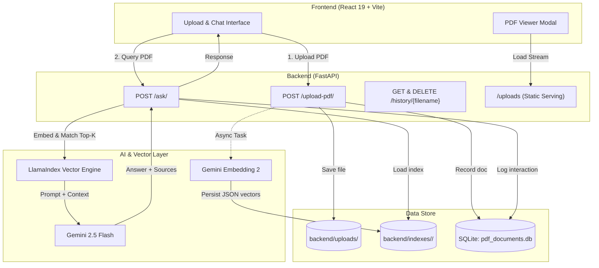

<div align="center">

# 📄 PDF Reviewer & AI Query Engine

**Chat with your PDF documents with grounded answers and verifiable page citations.**

Powered by **FastAPI**, **React 19**, **LlamaIndex**, and **Google Gemini 2.5 Flash**.

[](https://pdf-query-app-delta.vercel.app/)
[](https://fastapi.tiangolo.com)
[](https://react.dev/)
[](https://vitejs.dev/)
[](https://ai.google.dev/)
[](https://www.llamaindex.ai/)
[](https://www.docker.com/)

---

[Explore Features](#-key-features) •
[System Architecture](#-system-architecture) •
[API Reference](#-api-endpoints) •
[Docker Setup](#-docker-setup-recommended) •
[Quickstart](#-manual-quickstart-guide) •
[Environment Variables](#-environment-variables)

</div>

<br />

## 🌟 Overview

**PDF Reviewer** is a full-stack, AI-driven document intelligence platform. Users can upload any PDF—ranging from academic papers and technical specs to resumes and financial reports—and interact with its contents conversationally.

Instead of generic responses or hallucinations, the application uses **Retrieval-Augmented Generation (RAG)** to retrieve relevant document segments and pass them as context to **Gemini 2.5 Flash**, accompanied by **page-level source citations**.

---

## ✨ Key Features

- **⚡ Asynchronous Ingestion & Indexing**: PDF parsing and semantic embedding run in FastAPI background workers, keeping the UI instantaneous.
- **🧠 Semantic Vector Search**: Powered by `models/gemini-embedding-2` and LlamaIndex for high-accuracy similarity matching beyond keyword searches.
- **📑 Source Citations & Attribution**: Every answer provides collapsible source cards showing the exact page number and text snippet retrieved.
- **👁️ Live PDF Previewer**: Built-in modal viewer allows side-by-side reading of the original document while chatting.
- **💬 Persistent Guest Sessions**: Chat history is persisted per document and session in SQLite, allowing users to refresh or resume without losing context.
- **🎨 Polished UI/UX**: Built with React 19, Framer Motion animations, Markdown rendering, and real-time Toast notifications.

---

## 🏗️ System Architecture



---

## 🛠️ Tech Stack

| Domain | Technology | Description |
| :--- | :--- | :--- |
| **Frontend** | React 19, Vite | Fast, responsive single-page application |
| **Styling & UI** | Framer Motion, Bootstrap 5, React Icons | Smooth animations, layout, and visual feedback |
| **Markdown** | React Markdown | Formatted rendering of AI answers |
| **Backend** | FastAPI, Uvicorn | High-performance Python async web framework |
| **LLM & RAG** | LlamaIndex, Google Gemini API | `gemini-2.5-flash` (LLM) & `gemini-embedding-2` (Embeddings) |
| **PDF Extraction** | PyMuPDF, pypdf | Fast PDF text parsing and page metadata extraction |
| **Database** | SQLite, SQLAlchemy 2.0, Databases | Asynchronous database operations for document & chat history |
| **Deployment** | Vercel (Frontend), Render (Backend) | Cloud-native hosting setup |

---

## 📡 API Endpoints

| Method | Endpoint | Description | Request Body / Params |
| :--- | :--- | :--- | :--- |
| `POST` | `/upload-pdf/` | Uploads and initiates background indexing | Multipart Form: `file` (.pdf) |
| `POST` | `/ask/` | Queries the indexed PDF with RAG | JSON: `{ filename, question, session_id }` |
| `GET` | `/history/{filename}` | Retrieves session chat history for a PDF | Query: `session_id` |
| `DELETE` | `/history/{filename}` | Clears conversation history for a PDF | Query: `session_id` |
| `GET` | `/uploads/{filename}` | Serves the uploaded PDF file statically | URL path param |
| `GET` | `/` | Health check endpoint | None |

---

## 🐳 Docker Setup (Recommended)

Run the entire full-stack application (FastAPI backend + Nginx-served React frontend) with a single command.

### 1. Set Your Gemini API Key
Create a `.env` file at the project root (copied from [.env.example](file:///.env.example)):
```bash
cp .env.example .env
```
Add your key inside `.env`:
```env
GOOGLE_API_KEY=AIzaSy...
```

### 2. Run with Docker Compose
```bash
# Build and run backend and frontend
docker compose up --build
```
- **Frontend**: http://localhost:5173
- **Backend API & Swagger Docs**: http://localhost:8000/docs

> [!NOTE]
> Uploaded PDFs, generated vector indexes, and SQLite chat history are persisted in named Docker volumes (`backend_uploads`, `backend_indexes`, and `backend_data`).

### 🛠️ Development Mode with Hot-Reloading
If you are developing and want live code changes reflected instantly without rebuilding images:
```bash
docker compose -f docker-compose.dev.yml up --build
```

---

## 🚀 Manual Quickstart Guide

### 1. Prerequisites

- **Node.js** (v18+) & **npm**
- **Python** (v3.10+)
- **Google Gemini API Key** (obtainable from [Google AI Studio](https://aistudio.google.com/))

---

### 2. Clone the Repository

```bash
git clone https://github.com/shibinshibii/pdf-query-app.git
cd pdf-query-app
```

---

### 3. Backend Setup

```bash
cd backend

# Create and activate virtual environment
python -m venv venv
source venv/bin/activate  # On Windows: venv\Scripts\activate

# Install dependencies
pip install -r requirements.txt

# Configure environment variables
cp .env.example .env
```

Edit `backend/.env` with your credentials:
```env
DATABASE_URL=sqlite:///./pdf_documents.db
GOOGLE_API_KEY=your_actual_gemini_api_key_here
ALLOWED_ORIGINS=http://localhost:5173
```

Start the backend server:
```bash
uvicorn app.main:app --reload --port 8000
```
> Server will be live at `http://localhost:8000` (API Docs at `http://localhost:8000/docs`).

---

### 4. Frontend Setup

In a new terminal window:

```bash
cd frontend

# Install packages
npm install

# Configure environment variables
cp .env.example .env
```

Ensure `frontend/.env` points to your backend:
```env
VITE_API_URL=http://localhost:8000
```

Start the Vite development server:
```bash
npm run dev
```
> Application will be accessible at `http://localhost:5173`.

---

## ⚙️ Environment Variables

### Backend (`backend/.env`)

| Variable | Required | Description | Example |
| :--- | :--- | :--- | :--- |
| `GOOGLE_API_KEY` | **Yes** | API key for Gemini models and embeddings | `AIzaSy...` |
| `DATABASE_URL` | No | SQLite or PostgreSQL connection string | `sqlite:///./pdf_documents.db` |
| `ALLOWED_ORIGINS`| No | Comma-separated CORS allowed origins | `http://localhost:5173,https://my-app.vercel.app` |

### Frontend (`frontend/.env`)

| Variable | Required | Description | Example |
| :--- | :--- | :--- | :--- |
| `VITE_API_URL` | **Yes** | Base URL of the FastAPI backend server | `http://localhost:8000` or production URL |

---

## 💡 Usage Workflow

1. **Upload Document**: Drag & drop or select a `.pdf` file. A background task creates embeddings and persists the local vector index.
2. **Review in Real-time**: Click **Preview** to view the document inside the embedded viewer.
3. **Ask In-depth Questions**: Enter inquiries in the chat box (e.g., *"Summarize section 3"*, *"What qualifications are listed?"*).
4. **Inspect Sources**: Expand the source drawer under any response to verify citations and page references directly.
5. **Clear History**: Use the trash icon to reset the chat session for the current file.

---

## 📌 Limitations & Notes

- **Cold Starts (Free Hosting)**: If hosted on Render's free tier, the backend web service spins down after inactivity. Initial requests may take 30–50 seconds to wake up.
- **Rate Limits**: The free tier of the Gemini API has a standard request quota (monitor usage in [Google AI Studio](https://aistudio.google.com/)).
- **Document Scope**: Querying is currently performed per document. Multi-document cross-synthesis is not yet enabled.

---

## 🤝 Contributing

Contributions, issues, and feature requests are welcome!

1. Fork the Project
2. Create your Feature Branch (`git checkout -b feature/AmazingFeature`)
3. Commit your Changes (`git commit -m 'Add some AmazingFeature'`)
4. Push to the Branch (`git push origin feature/AmazingFeature`)
5. Open a Pull Request

---

## 📄 License

This project is open-source and available under the [MIT License](LICENSE).
