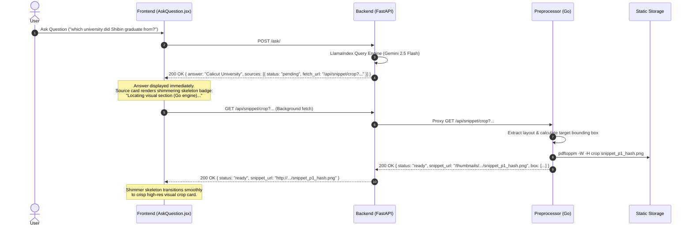

# 🔍 Universal Visual Source Citation Engine

> **Architecture, Layout Alignment Algorithms, and Asynchronous Microservice Design for Grounded Document Citations in PDF Reviewer.**

---

## 📑 Table of Contents
1. [Overview & Problem Statement](#1-overview--problem-statement)
2. [End-to-End System Architecture](#2-end-to-end-system-architecture)
3. [Universal Layout & Typography Engine](#3-universal-layout--typography-engine)
4. [Asynchronous Progressive Hydration Flow](#4-asynchronous-progressive-hydration-flow)
5. [Microservice Implementation & Coordinates](#5-microservice-implementation--coordinates)
6. [API Reference & Schema](#6-api-reference--schema)
7. [Multi-Document Test Suite](#7-multi-document-test-suite)

---

## 1. Overview & Problem Statement

### The Problem with Whole-Page Citations
Traditional RAG applications typically cite source information in one of two suboptimal ways:
1. **Raw Text Extracts**: A block of plaintext quotes stripped of formatting, tables, headings, and spatial structure.
2. **Whole-Page Thumbnails**: A scaled-down image of an entire $8.5 \times 11$ page. In multi-column papers, contracts, or crowded resumes, text is unreadable, and the user must search the entire page to find what the AI actually referenced.

### The Solution: High-Resolution Sub-Rectangle Visual Snippets
PDF Reviewer introduces a dedicated **Go-powered Visual Snippet Preprocessor** (`preprocessor/`) that:
- Pins down the **exact spatial bounding box** of the cited answer on the page using universal layout and typographic analysis.
- Renders an ultra-sharp **$180\text{ DPI}$ sub-rectangle crop** using Poppler's `pdftoppm`.
- Ships the AI response **instantly** to the frontend, while progressively hydrating visual citation cards with a friendly shimmer skeleton in the background.
- Operates in a **100% domain-agnostic manner**—delivering high precision on engineering task sheets, legal agreements, academic papers, product manuals, and resumes without hardcoded lexical rules.

---

## 2. End-to-End System Architecture

```
                    ┌────────────────────────────────────────────────────────┐
                    │               Frontend (React 19 + Vite)              │
                    │                                                        │
                    │  1. Instant Answer Display                             │
                    │  2. Progressive Shimmer Skeleton for Sources          │
                    │  3. Polished Visual Snippet Card with Click-to-Enlarge │
                    └──────────────────────────┬─────────────────────────────┘
                                               │
                        1. POST /ask/          │ 3. Asynchronous Fetch
                                               │    GET /api/snippet/crop?...
                                               ▼
                    ┌────────────────────────────────────────────────────────┐
                    │                 Backend (FastAPI Engine)               │
                    │                                                        │
                    │  • LlamaIndex Vector Retrieval (Gemini Embeddings)    │
                    │  • Gemini 2.5 Flash Synthesis                         │
                    │  • Salient Entity & Term Extraction                   │
                    │  • Returns Answer immediately with status: "pending"  │
                    │  • Proxies /api/snippet/crop to Go Service            │
                    └──────────────────────────┬─────────────────────────────┘
                                               │
                                               │ Forward Query, Answer & Terms
                                               ▼
                    ┌────────────────────────────────────────────────────────┐
                    │           Preprocessor Microservice (Go + Poppler)     │
                    │                                                        │
                    │  1. pdftotext -bbox-layout (Spatial XML Parsing)       │
                    │  2. Universal Typography & Relative Font Analysis      │
                    │  3. N-gram & Answer Entity Substring Alignment        │
                    │  4. Upward / Downward Section Boundary Crawling        │
                    │  5. Coordinate Scaling (72 pt -> 180 DPI px)          │
                    │  6. pdftoppm Sub-Rectangle PNG Cropping & MD5 Cache    │
                    └────────────────────────────────────────────────────────┘
```

---

## 3. Universal Layout & Typography Engine

The engine lives in [preprocessor/snippet.go](file:///data/hobby/pdf-reviewer/preprocessor/snippet.go). It avoids brittle domain dictionaries (e.g. `PROJECTS` or `EDUCATION`) and relies on **universal document geometry and text alignment**.

```
[Target PDF Page]
       │
       ▼
[pdftotext -bbox-layout] ──> Extracts XHTML hierarchy: <page> -> <flow> -> <block> -> <line> -> <word>
       │
       ▼
[Typographic Analysis]
  • Calculates median line height: H_median (body text baseline)
  • Identifies structural headings:
      - Line height >= 1.22 * H_median (larger font size)
      - Short all-caps text with letters (< 55 chars, no sentence punctuation)
      - Structural numbering prefix: "1.", "1.1", "Step 3", "Section 2", "Task 1", "Article 4"
       │
       ▼
[Content & N-Gram Alignment]
  • Answer 3-grams (+180 pts) & 2-grams (+70 pts)
  • Extracted entity phrases (+140 pts)
  • Salient answer tokens (+30 pts) & query tokens (+15 pts)
  • Explicit structural constraint (e.g. query asks for "Step 3" -> +500 pts)
  • De-weights top document headers (y < 110 pt) unless question is a title/author query
       │
       ▼
[Section Boundary Crawler]
  • Best matching anchor block found at index bestIdx
  • Upward Crawl: Walk backwards across bullet items/paragraphs until parent heading or gap > 32 pt
  • Downward Crawl: Accumulate subsequent lines until next structural heading or gap > 32 pt
  • Clamping: Clamp y1 <= nextHeadingYMin - 4 pt (never chops through subsequent headings)
```

### Relative Font Scaling vs. Fixed Font Sizes
Documents vary widely in DPI, point scaling, and base fonts. A 14pt line might be body text in a presentation slide, but a major title in a multi-column IEEE paper.
The Go engine resolves this by calculating the **median line height** across the entire page:
$$\text{IsHeading} = \text{True} \iff H_{\text{line}} \ge 1.22 \times H_{\text{median}}$$

---

## 4. Asynchronous Progressive Hydration Flow

To preserve sub-second conversational latency, visual cropping runs asynchronously rather than blocking the AI response:



If a distractor page retrieved during vector search does not contain the answer, the Go engine returns `status: "not_found"`, and the frontend cleanly hides the card to eliminate clutter.

---

## 5. Microservice Implementation & Coordinates

### Coordinate Systems & Scaling
PDFs define bounding boxes in **PDF Points** ($72\text{ DPI}$). However, to make visual snippets legible on retina and desktop displays, rendering runs at **$180\text{ DPI}$**:

$$\text{Scale Factor} = \frac{180}{72} = 2.5$$

$$X_{\text{px}} = \mathrm{round}(x_0 \times 2.5), \quad Y_{\text{px}} = \mathrm{round}(y_0 \times 2.5)$$
$$W_{\text{px}} = \mathrm{round}((x_1 - x_0) \times 2.5), \quad H_{\text{px}} = \mathrm{round}((y_1 - y_0) \times 2.5)$$

### Execution with Poppler CLI
The Go engine invokes `pdftoppm` with sub-rectangle clipping:
```bash
pdftoppm -png -r 180 -f {page} -l {page} -x {X_px} -y {Y_px} -W {W_px} -H {H_px} {pdfPath} {tempPrefix}
```

### Deterministic Content-Addressable Caching
Snippet paths are hashed using an MD5 digest of the page number and rounded coordinates:
$$\text{Hash} = \mathrm{MD5}\big(\text{"p\{page\}\_\{x0\}\_\{y0\}\_\{x1\}\_\{y1\}"}\big)[:10]$$
$$\text{Filename} = \text{snippet\_p\{page\}\_\{hash\}.png}$$
If a user asks a similar question targeting the same section, the preprocessor responds in $< 1\text{ ms}$ from cache.

---

## 6. API Reference & Schema

### `GET /api/snippet/crop`

Fetches or generates a visual sub-rectangle snippet for a cited page.

#### Query Parameters
| Parameter | Type | Required | Description | Example |
| :--- | :--- | :--- | :--- | :--- |
| `filename` | `string` | **Yes** | Sanitized filename of the uploaded PDF | `document.pdf` |
| `page` | `int` | **Yes** | Page number to crop (1-indexed) | `1` |
| `query` | `string` | No | User's question | `which university shibin graduated from` |
| `answer` | `string` | No | Synthesized LLM answer text | `Calicut University` |
| `terms` | `string` | No | Comma-separated salient entity keywords | `Calicut University,Calicut,University` |

#### Response Schema (`200 OK`)
```json
{
  "status": "ready",
  "filename": "document.pdf",
  "page": 1,
  "snippet_url": "http://localhost:8001/thumbnails/document.pdf/snippet_p1_7d8a9b2c3e.png",
  "box": {
    "x0": 54.3,
    "y0": 700.3,
    "x1": 486.3,
    "y1": 804.3
  }
}
```

When no confident section matches the citation:
```json
{
  "status": "not_found",
  "message": "No specific focused section matched"
}
```

---

## 7. Multi-Document Test Suite

The test suite in [preprocessor/snippet_test.go](file:///data/hobby/pdf-reviewer/preprocessor/snippet_test.go) validates the layout alignment engine against diverse document types:

```bash
cd preprocessor
go test -v ./...
```

| Test Case | Document Type | Source Document | Section Verified |
| :--- | :--- | :--- | :--- |
| `TestBackendTaskSheetTechStack` | Technical Specification | `Backend_Developer_Task_Sheet.pdf` | `Tech Stack (Strict Requirements)` + all bullet points |
| `TestOneDriveCloudStorage` | Product User Guide | `Getting_started_with_OneDrive.pdf` | `Cloud storage` heading + `5 GB free storage` text |
| `TestUserThreeQueries (University)` | Resume / Curriculum Vitae | `Shibin_P_Python_Developer.pdf` | `EDUCATION` + `Calicut University` ($y: 700 \to 804$) |
| `TestUserThreeQueries (Experience)` | Resume / Curriculum Vitae | `Shibin_P_Python_Developer.pdf` | `PROFESSIONAL SUMMARY` ($y: 166 \to 263$) |
| `TestUserThreeQueries (Skills)` | Resume / Curriculum Vitae | `Shibin_P_Python_Developer.pdf` | `SKILLS` ($y: 255 \to 376$) |
| `TestUserThreeQueries (Projects)` | Resume / Curriculum Vitae | `Shibin_P_Python_Developer.pdf` | `PROJECTS` ($y: 603 \to 708$) |

All tests execute in $< 0.15\text{s}$ using native Go and standard Poppler utilities.

